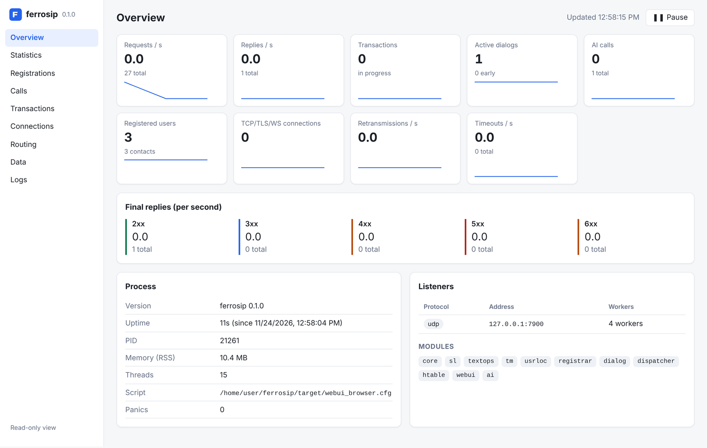
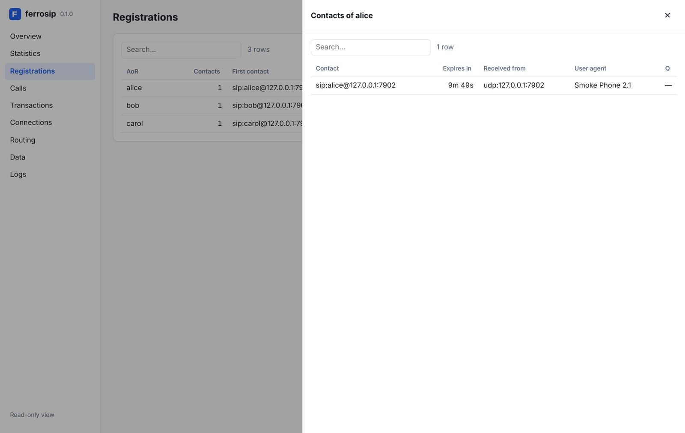
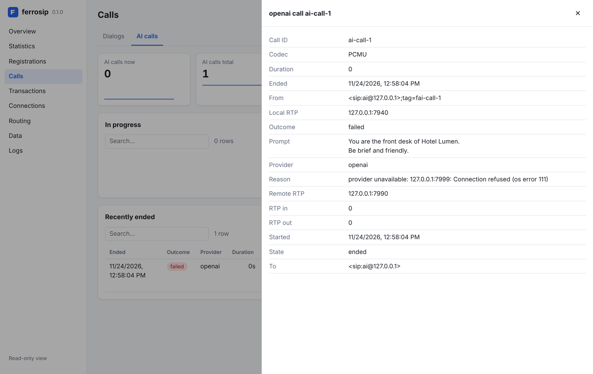
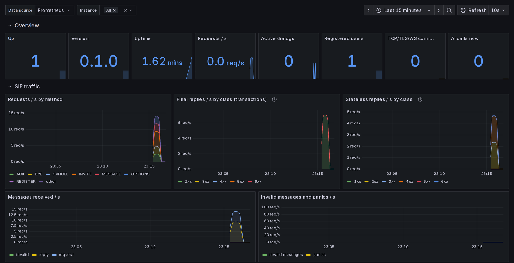
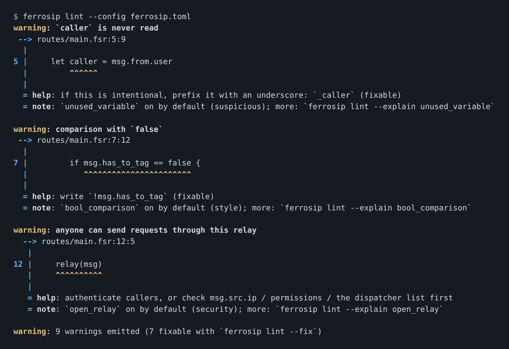
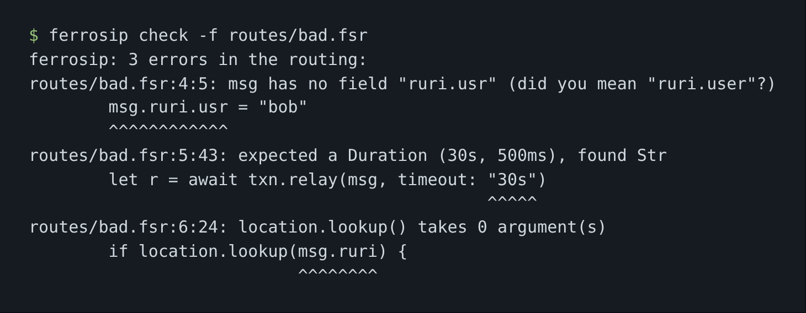

# ferrosip

ferrosip routes voice and video calls. It is a [SIP](docs/glossary.md#sip)
[proxy](docs/glossary.md#proxy) and [registrar](docs/glossary.md#registrar) in Rust, in the style of
[Kamailio](docs/glossary.md#kamailio). Phones register with it, and it forwards their
calls and messages over UDP, TCP, TLS and [WebSocket](docs/glossary.md#websocket). Use it
where you would use Kamailio: as the core of a VoIP service, a PBX, an
[SBC](docs/glossary.md#sbc) or an [IMS](docs/glossary.md#ims) network.

It is about 33,500 lines. Each architectural choice that makes Kamailio
fast is reproduced as a separate crate, so the design is easy to read.
New to the vocabulary? The [glossary](docs/glossary.md) explains each term.

- **Kamailio-compatible.** ferrosip runs Kamailio's own
  [`.cfg`](docs/glossary.md#cfg) language and [modules](docs/glossary.md#module) (tm, registrar, auth,
  dispatcher, dialog, rtpengine, presence, IMS, and about 90 others). The
  stock `kamailio.cfg` runs unmodified.
- **Fast.** On the same machine and load, ferrosip handles 2.5–3.6× the
  requests per second of Kamailio 6.1.5, with about a third of the CPU
  per request ([benchmarks](docs/benchmarks.md)).
- **A typed configuration.** [`ferrosip.toml`](docs/glossary.md#ferrosiptoml) says
  what runs. [`.fsr`](docs/glossary.md#fsr) is a typed routing language with
  [`await`](docs/glossary.md#await), events and tests. Kamailio configs convert with
  [`ferrosip import`](docs/glossary.md#import). [`ferrosip lint`](docs/glossary.md#lint) gives
  clippy-style suggestions.
- **Built to run.** It has limits, [graceful shutdown](docs/glossary.md#graceful-shutdown),
  [Prometheus metrics](docs/glossary.md#prometheus-metric), a [web UI](docs/glossary.md#web-ui) and a
  container image. CI covers end-to-end tests for every module group,
  [SIPp](docs/glossary.md#sipp) interop, soak runs and fuzzing.

## Quick start

```bash
cargo build --release
target/release/ferrosip -f etc/ferrosip.cfg -l udp:127.0.0.1:5060    # a Kamailio-style script
target/release/ferrosip --config examples/fsr/ferrosip.toml           # ferrosip.toml + .fsr routing
target/release/ferrosip check --config examples/fsr/ferrosip.toml     # check only, like kamailio -c
target/release/ferrosip test --config examples/fsr/ferrosip.toml examples/fsr/routes/main_test.fsr  # test blocks
target/release/ferrosip lint --config examples/fsr/ferrosip.toml      # clippy-style suggestions
target/release/ferrosip import kamailio.cfg -o myproxy                # a Kamailio config → toml + .fsr
target/release/ferroctl stats.get_statistics all                      # RPC, like kamcmd
```

A routing in `.fsr`:

```rust
import location

route main(msg: Request) {
    guard msg.max_forwards > 0 else reply(TooManyHops)
    if msg.method == REGISTER {
        location.save()
    }
    let found = location.lookup() else return reply(NotFound)
    let res = await txn.relay(msg, timeout: 30s)
    match res {
        Final(r) if r.code == BusyHere => voicemail(msg)
        Final(r) => forward(r)
        Timeout => reply(RequestTimeout)
    }
}

fn voicemail(msg: Request) {
    msg.ruri = "sip:vm@127.0.0.1:5090"
    relay(msg)
}
```

## Screenshots

| | |
|---|---|
| [](docs/screenshots/webui-overview.png) | [](docs/screenshots/webui-registrations.png) |
| **Web UI**: live counters, replies by class, process and listeners ([mod-webui](crates/mod-webui/README.md)) | **Web UI**: registrations, with each [AoR](docs/glossary.md#aor)'s contacts |
| [](docs/screenshots/webui-ai-call.png) | [](docs/screenshots/grafana.png) |
| **Web UI**: a voice AI call and its details ([mod-ai](crates/mod-ai/README.md)) | **Grafana**: the bundled dashboard over the Prometheus exporter ([examples/monitoring](examples/monitoring/)) |
| [](docs/screenshots/lint.png) | [](docs/screenshots/check.png) |
| **`ferrosip lint`**: clippy-style suggestions, most of them fixable ([lint.md](docs/lint.md)) | **`ferrosip check`**: `.fsr` type errors with positions and "did you mean" ([fsr.md](docs/fsr.md)) |

## Documentation

All of it, as a searchable site: <https://rustedbytes.github.io/ferrosip/>.

| | |
|---|---|
| [Glossary](docs/glossary.md) | the project's jargon (SIP, Kamailio, IMS and Diameter, ferrosip) in plain English, one entry per term |
| [Running ferrosip](docs/running.md) | building, the command line, `ferrosip.toml` and `.fsr` in short, containers, management (RPC, statistics, databases), behaviour under limits, failures and shutdown |
| [ferrosip.toml](docs/config-toml.md) | the configuration file: layers, `${ENV}`, features, module names and order |
| [`.fsr`](docs/fsr.md) | the typed routing language: `await`, events, shared state, tests, the escape hatch to Kamailio |
| [`.cfg` scripts](docs/script.md) | the Kamailio-style language, running Kamailio configs, failure and reply routes, `cfg.reload` |
| [Kamailio compatibility](docs/kamailio-compat.md) | how far Kamailio's own configs go, and how that is checked |
| [`ferrosip import`](docs/import.md) | converting a Kamailio `.cfg` to `ferrosip.toml` + `.fsr` |
| [`ferrosip lint`](docs/lint.md) | the linter; every lint in [lints-reference.md](docs/lints-reference.md) |
| [Registrar, auth, forking](docs/sip.md) | registration and the location table, digest authentication, forking and RFC 3263 |
| [Modules](docs/modules-overview.md) | an overview of every module group |
| [Module parameters](docs/modules-reference.md), [`.fsr` functions](docs/functions-reference.md) | generated references (`ferrosip schema`) |
| [Architecture](docs/architecture.md) | the source layout, Kamailio → ferrosip mapping, TCP/TLS and WebSocket design |
| [Benchmarks](docs/benchmarks.md) | ferrosip and Kamailio on the same machine |
| [Scenarios](examples/scenarios/README.md) | 40 runnable configurations, small to multi-proxy, each with its edge cases tested end to end |
| [Testing, fuzzing and CI](docs/testing.md) | running the tests, the fuzz targets, what CI checks |
| [Design notes](docs/design-notes.md) | lessons from building it; what was left out |

## Crate documentation

Each crate has its own README with the full reference:
- what it ports;
- parameters with defaults;
- script functions and [return codes](docs/glossary.md#return-code-convention);
- [pseudo-variables](docs/glossary.md#pseudo-variable-pv), [RPC](docs/glossary.md#rpc) commands and
  [event routes](docs/glossary.md#event-route);
- examples and differences from Kamailio.

The overviews are in [docs/modules-overview.md](docs/modules-overview.md).

| Crate | Modules (ferrosip name, Kamailio modules) and contents |
|---|---|
| [`ferrosip`](bin/ferrosip/README.md) | the server: startup sequence, command-line options, `cfg.reload` |
| [`ferroctl`](tools/ferroctl/README.md) | RPC client (like `kamcmd`) and script formatter (`ferroctl fmt`) |
| [`sipflood`](tools/sipflood/README.md) | load generator and dummy UAS used for all benchmarks |
| [`sip-parser`](crates/sip-parser/README.md) | zero-copy, lazy SIP parser; URI and Contact parsing; stream framing |
| [`sip-core`](crates/sip-core/README.md) | core: message context, modules, pseudo-variables, RPC, statistics, DNS, timers, shared tables, core functions |
| [`sip-script`](crates/sip-script/README.md) | script language: lexer, parser, compiler, routes, live reload |
| [`sip-transport`](crates/sip-transport/README.md) | UDP, TCP, TLS, WS and WSS transports; connection handling |
| [`sip-db`](crates/sip-db/README.md) | database layer: db_text, SQLite, MySQL/MariaDB, PostgreSQL |
| [`sip-diameter`](crates/sip-diameter/README.md) | Diameter base protocol (RFC 6733): codec, peers, Kamailio XML config |
| [`mod-txn`](crates/mod-txn/README.md) | `txn` (tm, tmx): transactions, forking, CANCEL, timers, failure routes, `t_uac` |
| [`mod-maxfwd`](crates/mod-maxfwd/README.md) | part of `sip` (maxfwd): Max-Forwards |
| [`mod-location`](crates/mod-location/README.md) | `location` (registrar + usrloc): `save`, `lookup`, `registered`, `lookup_branches`, `unregister`, `reg_fetch_contacts` + `$ulc`; Path, GRUU, outbound; the location table, expiry, database modes |
| [`mod-auth`](crates/mod-auth/README.md) | `auth` (auth, auth_db), `auth_ephemeral`: digest authentication |
| [`mod-dialog`](crates/mod-dialog/README.md) | `dialog` (dialog, dlgs): state machine, timeouts, profiles, dialog variables |
| [`mod-sip`](crates/mod-sip/README.md) | `stateless` (sl), `text` (textops, textopsx), `sip` (siputils, sanity), `log` (xlog), `utils` (cfgutils, corex, kex), `stats` (statistics), `vars` (pv), `ip` (ipops), `blocklist` (blst) |
| [`mod-routing`](crates/mod-routing/README.md) | `route_set` (rr), `path`, `nat` (nathelper), `balancer` (dispatcher), `acl` (permissions), `domains`, `aliases` (alias_db), `groups` |
| [`mod-limits`](crates/mod-limits/README.md) | `shared_tables` (htable), `limits` (pike, ratelimit), `pipe_limits`, `security_filter`, `blocklist` (userblocklist) |
| [`mod-media`](crates/mod-media/README.md) | `media` (rtpengine; ng protocol, also rtpflux) |
| [`mod-carrier`](crates/mod-carrier/README.md) | `dialplan`, `carriers` (lcr), `cdr` (acc), `client` (uac), `topology` (topoh, topos) |
| [`mod-presence`](crates/mod-presence/README.md) | `presence` (presence, presence_xml, presence_dialoginfo), `presence_client` (pua, pua_dialoginfo), `shared_lines` (sca), `offline_messages` (msilo), `resource_lists` (rls) |
| [`mod-extra`](crates/mod-extra/README.md) | `trace` (siptrace), `credit` (cnxcc), `txn` (tmx), `redirect` (uac_redirect), `vars` (avpops), `sql` (sqlops), `prefix_tree` (mtree), `prefix_routes`, `speed_dial`, `enum`, `outbound`, `pending_calls` (tsilo), `timers` (rtimer), `http` (xhttp), `http_metrics` (xhttp_prom), `redis` (ndb_redis) |
| [`mod-lua`](crates/mod-lua/README.md) | `lua` (app_lua; KEMI-style `KSR` API) |
| [`mod-ims`](crates/mod-ims/README.md) | IMS: `diameter` (cdp), P-/I-/S-CSCF modules, ims_ipsec_pcscf, ims_qos, ims_charging |
| [`mod-async`](crates/mod-async/README.md) | `async`, `http` (http_async_client), `http_client`, `json_doc` (jansson), `json`, `admin` (jsonrpcs) |
| [`mod-ops`](crates/mod-ops/README.md) | `keepalive`, `sip_dump` (sipdump), `events` (evapi) |
| [`mod-webui`](crates/mod-webui/README.md) | webui: read-only admin web UI (Preact + TypeScript, embedded) and its JSON API |
| [`mod-prometheus`](crates/mod-prometheus/README.md) | prometheus: Prometheus exporter (native names, labels, latency histograms, process metrics); Grafana dashboard in `examples/monitoring` |
| [`mod-ai`](crates/mod-ai/README.md) | ai: answer SIP calls with a realtime voice AI (OpenAI Realtime, Gemini Live), prompt from the call |

## License

Copyright (C) 2026 Yehor Smoliakov <egorsmkv@gmail.com>

ferrosip is free software, licensed under the GNU General Public License,
version 3 or (at your option) any later version (`GPL-3.0-or-later`). See
[LICENSE](LICENSE) for the full text.

The Kamailio configs vendored in `tests/compat/kamailio/` keep their own
license, GPL-2.0-or-later, and the copyright of their Kamailio authors.
