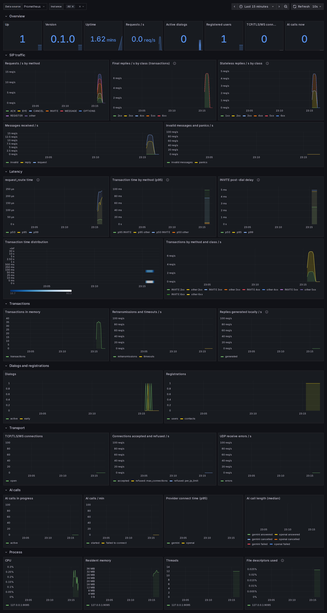

# Monitoring: Prometheus + Grafana

This example gives you ready-made dashboards for a running ferrosip. It
runs ferrosip with the `prometheus` module, a Prometheus server that
scrapes its [metrics](../../docs/glossary.md#prometheus-metric), and a
provisioned [Grafana](../../docs/glossary.md#grafana) dashboard. Use it to
try the dashboard, or as a template for your own monitoring.

```bash
cd examples/monitoring
docker compose up -d --build
python3 smoke.py                 # 40 s of SIP traffic, then checks every panel has data
```

Open http://127.0.0.1:3000. The **ferrosip** dashboard is the home page.
You're logged in as an anonymous viewer. Use admin / admin to edit.
Prometheus is at http://127.0.0.1:9090.



## The dashboard

[`grafana/dashboards/ferrosip.json`](grafana/dashboards/ferrosip.json)
works in any Grafana 11 or newer:
- Import it.
- Pick your Prometheus datasource (the `datasource` variable).
- `instance` selects one or more ferrosip servers.

| Row | Panels |
|---|---|
| Overview | Up, version, uptime, requests/s, active dialogs, registered users, connections, AI calls |
| SIP traffic | Requests/s by method; final replies/s by class (transactions); stateless replies/s by class; messages by kind; invalid messages and panics |
| Latency | `request_route` time p50/p95/p99; transaction time by method; INVITE post-dial delay; a transaction-time heatmap; transactions/s by method and class |
| Transactions | In memory, retransmissions and timeouts/s, locally generated replies/s |
| Dialogs and registrations | Dialogs by state; users and contacts |
| Transport | Connections; accepted and refused/s (by reason); UDP receive errors |
| AI calls | In progress, started and failed per minute, provider connect time, call length |
| Process | CPU, resident memory, threads, open file descriptors |

The glossary explains the SIP terms in this table:
[dialog](../../docs/glossary.md#dialog),
[method](../../docs/glossary.md#method),
[final reply](../../docs/glossary.md#final-reply),
[transaction](../../docs/glossary.md#transaction),
[stateless](../../docs/glossary.md#stateless-proxy),
[`request_route`](../../docs/glossary.md#request-route),
[INVITE](../../docs/glossary.md#invite),
[retransmission](../../docs/glossary.md#retransmission) and
[Contact](../../docs/glossary.md#contact).

The metrics are described in
[`crates/mod-prometheus`](../../crates/mod-prometheus/README.md).

## The stack

| Service | Listens on | Notes |
|---|---|---|
| ferrosip | SIP 127.0.0.1:5060 (UDP and TCP), metrics 127.0.0.1:9095 | [`ferrosip.cfg`](ferrosip.cfg): registrar + proxy with dialogs; `ai` is loaded (no key: its panels stay at zero) |
| Prometheus | 127.0.0.1:9090 | [`prometheus.yml`](prometheus.yml): scrapes every 5 s, keeps 7 days |
| Grafana | 127.0.0.1:3000 | Datasource and dashboard provisioned from [`grafana/provisioning`](grafana/provisioning) |

- All services use the host network, because SIP needs real addresses (see
  the main `docker-compose.yml`).
- To expose them:
  - change the listen addresses;
  - set a Grafana admin password;
  - give ferrosip a `bearer_token_file`. The commented lines in
    `prometheus.yml` show the matching scrape setting.

## Checks

[`smoke.py`](smoke.py) and the `Monitoring example` CI workflow do these:
1. Register a phone and send calls (ringing, answered, hung up),
   MESSAGEs, OPTIONS, and calls to an unknown user.
2. Check that ferrosip's `/metrics` exports every metric the dashboard
   uses.
3. Check that Prometheus scrapes it.
4. Run every panel query and check it returns data. The AI panels may be
   empty: no AI calls are made.
5. Check that Grafana serves the provisioned dashboard and can query the
   datasource.

CI also runs `promtool check metrics` on the output and renders the
screenshot above ([`screenshot.mjs`](screenshot.mjs)).
